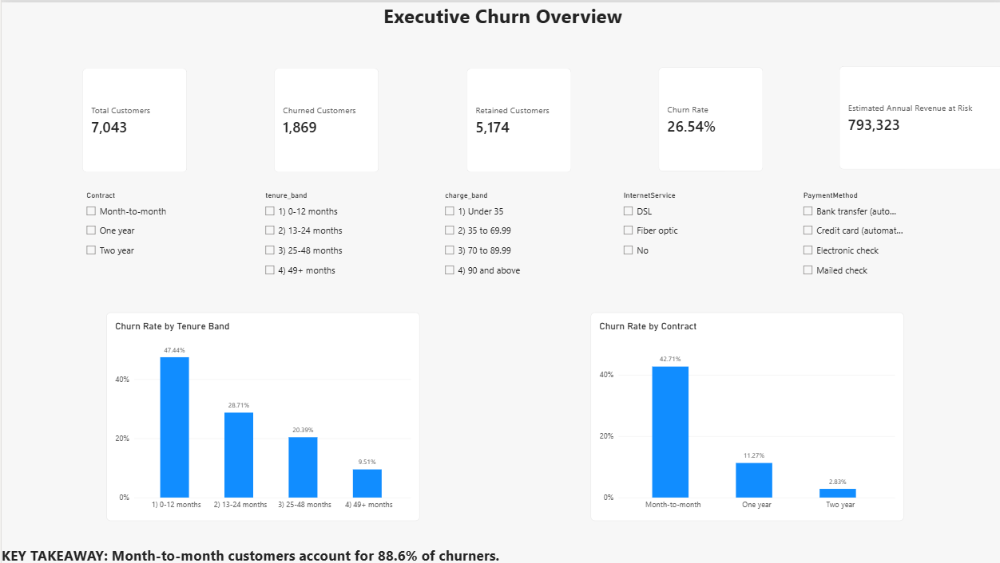
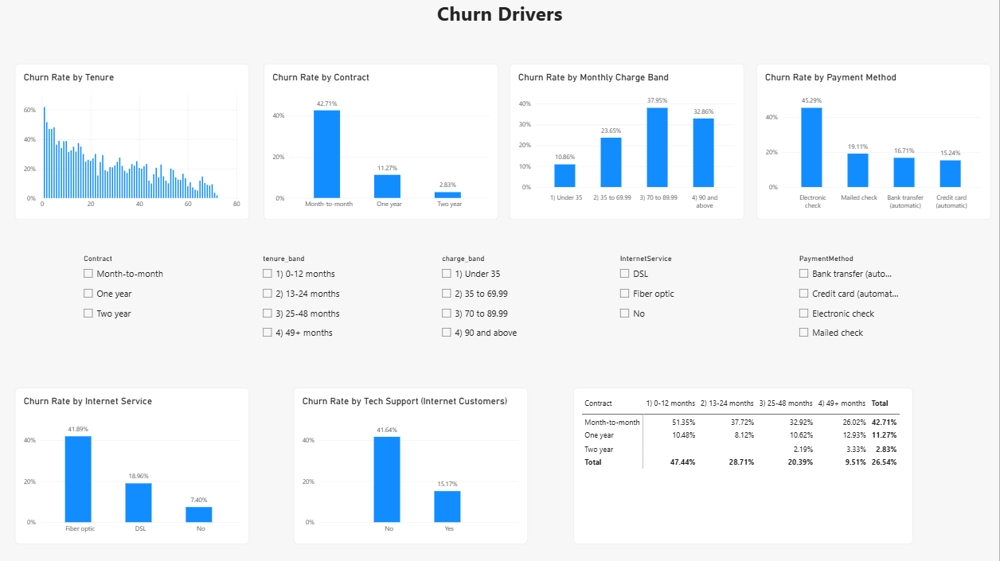
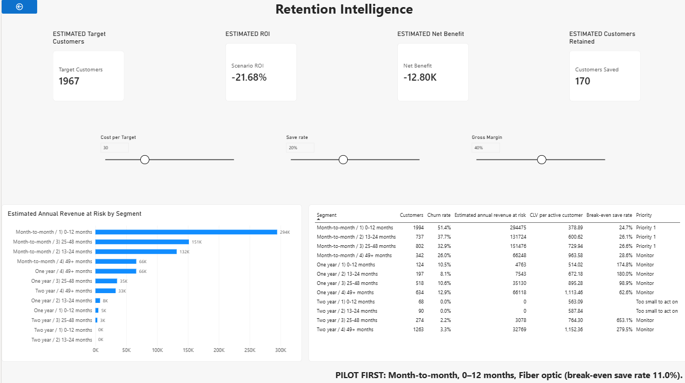

# Telco Customer Churn & Retention Business Case

**Business Analytics | Business Analysis | SQL | Power BI | Excel | DAX | Customer Analytics**

## 1. Project Overview

This project analyses customer churn for a telecom company and develops a data-driven business case for a targeted customer retention programme.

The analysis combines SQL, Power BI, Excel financial modelling and Business Analysis documentation to answer:

- Which customer segments have the highest churn?
- Which segments represent the greatest revenue exposure?
- Which churn drivers should the business investigate?
- Which customer segments should be prioritised for retention?
- What retention investment could be financially justified?
- What should be tested before scaling a retention programme?

The project is designed as a Business Analyst / Business Analytics portfolio project. It focuses on turning analysis into business decisions, not on building a machine-learning churn prediction model.

**Note on currency:** the dataset does not state a currency. All money figures are shown in currency units (**CU**).

---

## 2. Business Problem

The telecom company is losing customers. In the available dataset:

- 7,043 customers are analysed.
- 1,869 customers have churned.
- The overall churn rate is **26.54%**.
- Churned customers contribute **139,130.85 CU** in monthly billing, which is **30.5%** of the dataset's monthly billing.

The business needs to decide:

> Which customer segments should receive a targeted retention programme, what type of intervention should be tested, and what level of retention spend could be justified?

The retention budget is assumed to be limited, so the objective is not to target every customer. The analysis prioritises segments using churn rate, customer volume, revenue exposure and estimated financial return.

---

## 3. Business Objectives

### Business objectives

1. Reduce churn in segments with the greatest revenue exposure.
2. Allocate retention budget where the expected return justifies the spend.
3. Identify segments suitable for a pilot before wider rollout.

### Analytical objectives

- Measure overall churn.
- Identify major churn patterns across contract, tenure, pricing, services and payment method.
- Identify high-risk customer segments.
- Quantify estimated revenue exposure.
- Estimate customer lifetime value (CLV).
- Evaluate retention scenarios.
- Calculate break-even save rates and scenario ROI.
- Translate findings into segment-specific recommendations.

---

## 4. Dataset

**Source:** IBM Telco Customer Churn sample dataset (Kaggle: https://www.kaggle.com/datasets/blastchar/telco-customer-churn).

- 7,043 customers
- 21 original columns
- Public sample dataset, single snapshot
- Currency not specified in the source data

The dataset contains customer demographics, tenure, contract type, internet service, add-on services, monthly charges, payment method, total charges and churn status.

A cleaned version is provided in `data/telco_customer_churn_clean.csv`.

---

## 5. Data Cleaning

The raw dataset was reviewed before analysis.

### Key cleaning decisions

- Verified 7,043 unique customer IDs (no duplicates).
- Found 11 blank `TotalCharges` values. All 11 had tenure = 0 (new customers not yet billed), so they were set to 0 and the column was converted to numeric.
- No customer rows were removed.
- Created a binary `churn_flag`.
- Created four tenure bands: 0-12, 13-24, 25-48 and 49+ months.
- Created four monthly charge bands: under 35, 35 to 69.99, 70 to 89.99 and 90 and above.
- Created an add-on count (`num_addons`).
- Checked category consistency, outliers and consistency of the "No internet service" and "No phone service" labels.

The full cleaning logic is in `sql/01_data_quality.sql`.

---

## 6. Analytical Approach

The project follows a Business Analysis workflow:

1. Business problem definition
2. Stakeholder analysis
3. Scope definition
4. Business Requirements Document (BRD)
5. KPI tree
6. Data quality and cleaning
7. SQL analysis
8. Customer segmentation
9. Revenue-at-risk modelling
10. CLV modelling
11. Retention scenario analysis
12. Power BI dashboard
13. UAT
14. Traceability and final recommendations

---

## 7. SQL Analysis

Five SQL scripts are included. They were written and tested in SQLite and use standard SQL (CTEs, `CASE`, window functions, `HAVING`).

### `01_data_quality.sql`
Row count, unique customers, blank `TotalCharges`, category consistency, and the cleaned analysis table `telco_clean`.

### `02_kpi_analysis.sql`
Overall churn, churn by contract, tenure and monthly charge band, and high-risk contract x tenure combinations.

### `03_churn_drivers.sql`
Internet service, phone service, add-on services, number of add-ons, payment method, paperless billing, demographics, and combined segments (minimum 100 customers per group).

### `04_customer_segmentation.sql`
Builds 12 segments from **Contract x Tenure band**. Each segment is evaluated on customer count, churn rate, active customers, estimated revenue at risk, share of total revenue risk and retention priority. Segments with fewer than 100 customers are treated as too small to act on.

### `05_revenue_risk.sql`
Churned monthly revenue, annualised churned revenue, total monthly revenue, churned revenue share, average monthly charges and the CLV model inputs.

---

## 8. Key Findings

All rates below are calculated from the dataset. They describe associations, not causes.

### Contract
Month-to-month customers churn at **42.7%**, compared with 11.3% (one year) and 2.8% (two year). Month-to-month customers account for **88.6% of all churners**.

### Tenure
Churn is highest among newer customers: 0-12 months **47.4%**, 13-24 months 28.7%, 25-48 months 20.4%, 49+ months 9.5%. The 0-12 month group holds 55.5% of all churners.

### Internet service
Fiber customers churn at **41.9%**, compared with DSL 19.0% and no internet service 7.4%. The fiber gap remains inside every contract type (for month-to-month customers: fiber 54.6%, DSL 32.2%), so it is not explained by contract alone.

### Payment method
Electronic-check customers churn at **45.3%**, compared with mailed check 19.1%, bank transfer 16.7% and credit card 15.2%.

### Support add-ons
Customers with tech support churn at 15.2% versus 41.6% for internet customers without it. Customers who choose these services may already be more engaged, so this is an association only.

### Revenue exposure
Estimated annual revenue at risk is approximately **793,323 CU** (assumption-based, not observed lost revenue). About **72.8%** of it sits in three month-to-month segments.

---

## 9. Customer Segmentation

Customers are segmented by **Contract x Tenure band**, giving 12 actionable segments. Both attributes are known before a campaign starts, showed the largest churn differences, and can be acted on by marketing.

**Method:**
- Churn rate = churned customers / customers in the segment.
- Estimated annual revenue at risk = active monthly revenue x segment churn rate x 12.
- Priority 1: at least 100 customers, churn above the overall rate, and at least 10% of total estimated revenue at risk.

The Priority 1 segments are month-to-month customers with **0-12, 13-24 and 25-48 months** of tenure. Very small groups (two-year customers with 0-24 months of tenure) are flagged and not used for conclusions.

Within the first of these segments, **month-to-month, 0-12 months, fiber optic** customers churn at **70.2%** (916 customers, 273 still active).

The segment output used by Power BI is `data/segments_for_powerbi.csv`.

---

## 10. Power BI Dashboard

The dashboard has three pages.

### Page 1: Executive Churn Overview
Total, churned and retained customers, overall churn rate, estimated annual revenue at risk, churn by tenure band, churn by contract, and interactive filters. The dataset has no dates, so churn by tenure band is used instead of a trend over time.

### Page 2: Churn Drivers
Churn by tenure, contract, monthly charge band, payment method, internet service and tech support, plus a contract x tenure matrix.

### Page 3: Retention Intelligence
Segment table, estimated revenue at risk by segment, retention priority, CLV, break-even save rate, and a what-if scenario (save rate, cost per target, gross margin) showing estimated customers saved, net benefit and ROI.

The Power BI file is `powerbi/Telco_Churn_Dashboard.pbix`.

### Dashboard preview







---

## 11. Excel Financial Model

`excel/Retention_Business_Case.xlsx` evaluates the financial case with live formulas. Sheets: Assumptions, Segments, Scenarios, Sensitivity, Focused and Notes.

It includes segment economics, CLV, retention scenarios, a sensitivity table, a focused-segment scenario and break-even save rates.

Base assumptions: gross margin 40%, discount rate 10%, CLV horizon 5 years, cost per targeted customer 30 CU, save-rate scenarios 10%, 20% and 30%.

---

## 12. Business Recommendation

### Recommended first pilot

A targeted intervention for **month-to-month customers, 0-12 months, fiber optic** (273 active customers).

At the assumed cost of 30 CU per targeted customer, the **estimated break-even save rate is 11.0%** (12-month gross-margin basis). A blanket programme across all three Priority 1 segments (1,967 customers) needs an estimated **25.5%** save rate.

The pilot should use a randomised holdout group before any wider rollout.

### Additional actions to test

1. Early-tenure onboarding contact.
2. Autopay migration for electronic-check customers.
3. Service check-in and support bundle for new fiber customers.
4. Contract migration offers where economically justified.
5. First-year customer engagement programme.

The analysis does not claim that these factors cause churn. They are associations identified for targeted testing.

---

## 13. Scenario Analysis

The model treats the observed churn proportion as an annual churn probability. This is an assumption, made because a 26.54% monthly churn rate would imply an average customer life under four months, while the observed average tenure is 32.4 months.

Base scenario: save rate 20%, cost 30 CU per targeted customer, gross margin 40%.

For the three Priority 1 segments (1,967 target customers), the **estimated net benefit is approximately -12.8K CU and the estimated ROI is approximately -21.7%**. At a 30% save rate the estimated ROI turns positive (about +17.5%).

This matters because the analysis does not simply recommend spending on retention. It tests whether the intervention can earn an acceptable return, and shows that a focused segment has a much lower break-even save rate than a blanket programme.

---

## 14. UAT and Quality Assurance

The project includes UAT test cases, an independent pre-verification of their expected values, a requirements traceability matrix, a KPI tree, data quality checks, SQL validation and Excel scenario validation.

The expected values for the UAT cases were recomputed independently from the cleaned data and the Excel model (45 checks, 0 mismatches, logged in `documentation/UAT_Preverification.csv`). Execution results are recorded in the Actual result and Status columns of `documentation/UAT_Test_Cases.md`.

UAT covers overall KPIs, contract, tenure, charge band and payment churn, dashboard slicers, the segment matrix, small groups, priority labels, revenue at risk, churned revenue, CLV, retention scenarios, Excel recalculation and the labelling of estimated values.

---

## 15. Assumptions

These figures are model assumptions, not observed facts:

- The observed churn proportion is treated as an annual churn probability.
- Gross margin = 40%.
- Discount rate = 10%.
- CLV horizon = 5 years.
- Retention cost = 30 CU per targeted customer.
- Save rates = 10%, 20% and 30%.
- A segment needs at least 100 customers to be acted on (analytical rule).

All assumption-based financial figures are labelled as estimated.

---

## 16. Limitations

- The dataset has no dates, so a true churn trend cannot be calculated.
- There are no recorded reasons for churn.
- Retention costs and offer effectiveness are not provided.
- Currency is not specified.
- The dataset is a public IBM sample, not real company data.
- The analysis is observational and does not establish causality.
- Monthly charges are the current bill, not a historical billing series.
- Network quality, geography, competitor pricing and customer complaints are not available.
- For churned customers the tenure band is tenure at departure; for active customers it is tenure to date.

The recommendations are hypotheses to test through controlled retention experiments, not proof of causation.

---

## 17. Project Structure

```text
Telco-Customer-Churn-Retention/
|
|-- README.md
|
|-- data/
|   |-- WA_Fn-UseC_-Telco-Customer-Churn.csv
|   |-- telco_customer_churn_clean.csv
|   `-- segments_for_powerbi.csv
|
|-- sql/
|   |-- 01_data_quality.sql
|   |-- 02_kpi_analysis.sql
|   |-- 03_churn_drivers.sql
|   |-- 04_customer_segmentation.sql
|   `-- 05_revenue_risk.sql
|
|-- powerbi/
|   `-- Telco_Churn_Dashboard.pbix
|
|-- excel/
|   `-- Retention_Business_Case.xlsx
|
|-- documentation/
|   |-- BRD.md
|   |-- KPI_Tree.md
|   |-- Traceability_Matrix.md
|   |-- UAT_Test_Cases.md
|   `-- UAT_Preverification.csv
|
`-- screenshots/
    `-- dashboard_images/
        |-- _Executive_Churn_Overview.png
        |-- _Churn_Drivers.png
        `-- _Retention_Intelligence.png
```

---

## 18. Reproducibility

To review the project:

1. Start with `README.md`.
2. Read `documentation/BRD.md` for the business requirements.
3. Read `documentation/KPI_Tree.md` for the analytical framework.
4. Review the raw and cleaned datasets in `data/`.
5. Run the SQL scripts in `sql/`:
   - Load `data/WA_Fn-UseC_-Telco-Customer-Churn.csv` into a table named `telco_raw` (the scripts expect this name).
   - Run `01` to `05` in order. Script `01` creates the cleaned table `telco_clean` that the others use.
   - The scripts were tested in SQLite. For MySQL or SQL Server, replace `||` with `CONCAT()` and rewrite the add-on count in `01` with `CASE WHEN ... THEN 1 ELSE 0 END`.
6. Open `excel/Retention_Business_Case.xlsx` to review the financial model.
7. Open `powerbi/Telco_Churn_Dashboard.pbix` to explore the dashboard.
8. Review `documentation/UAT_Test_Cases.md` and `documentation/Traceability_Matrix.md` for validation.

---

## 19. Skills Demonstrated

**Business Analysis:** business problem definition, stakeholder analysis, requirements gathering, BRD, KPI tree, scope definition, traceability matrix, UAT, business recommendations.

**Data & Analytics:** SQL, data cleaning, customer segmentation, churn analysis, revenue-at-risk analysis, CLV modelling, scenario analysis, ROI analysis.

**Tools:** SQL, Power BI, DAX, Excel, Git/GitHub, Markdown.

**Data storytelling:** the project turns customer-level data into a single chain:
Business problem -> KPIs -> churn drivers -> segments -> financial exposure -> retention scenarios -> business recommendation.

---

## 20. Final Outcome

The analysis recommends starting with a **focused retention pilot** rather than a blanket programme.

The strongest initial opportunity is the early-tenure, month-to-month, fiber-optic segment, supported by a controlled experiment and explicit break-even criteria (an estimated 11.0% save rate at 30 CU per targeted customer).

The project demonstrates the Business Analyst workflow from requirements and data analysis through dashboarding, financial modelling, validation and actionable recommendations.